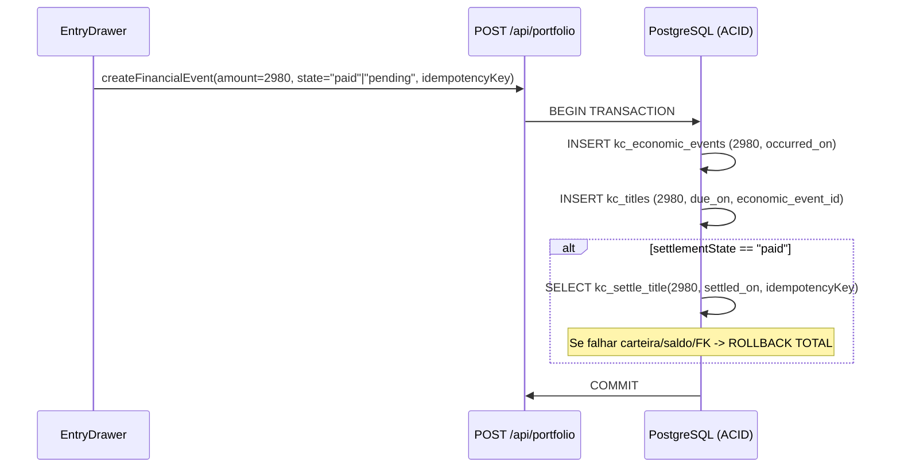

# BUD-00 · Diagnóstico do Projeto, Mapa de Lacunas, Modelo Proposto e Plano de Implementação

- **Issue principal:** [jukazilli/kuantoconta#14](https://github.com/jukazilli/kuantoconta/issues/14)
- **ADR associada:** [ADR-008](../adr/ADR-008-budgets-economic-events-and-projection.md)
- **Data da auditoria:** 17/11/2026
- **Branch / HEAD inspecionados:** `feat/scoped-cancel-financial-series` (PR #12), SHA `ed5d1f8a3bccdae3774d9bf41aadecc11481fad4`

---

## 1. Diagnóstico do Projeto (Estado Real Verificado)

### 1.1 Estado do Git e Cadeia de PRs
`main` (`b044c74`) contém apenas o commit inicial. Toda a aplicação V1 está distribuída em uma cadeia sequencial de **4 PRs Draft abertas** no GitHub (todas com CI `kuantoconta desktop CI` / `verify` em `SUCCESS`):

| PR | Branch | Base | HEAD SHA | Status |
|---|---|---|---|---|
| #9 | `feat/foundation-desktop-v1` | `main` | `9a1bca9a7fbf63eda33ab9f6f2c10882c3ba1d9d` | Draft OPEN (CI PASS) |
| #10 | `feat/ux-money-range-movements` | #9 | `d1e340332eb2cf67e844f5fb20b94648d1173aba` | Draft OPEN (CI PASS) |
| #11 | `fix/finance-display-settlement-undo-recurring` | #10 | `2d1f85566dd458abc7511e8a85265d13b262ae8f` | Draft OPEN (CI PASS) |
| #12 | `feat/scoped-cancel-financial-series` | #11 | `ed5d1f8a3bccdae3774d9bf41aadecc11481fad4` | Draft OPEN (CI PASS) |

### 1.2 Stack e Testes Verificados (`apps/web/package.json`)
- **Framework:** Next.js `16.4.6` (App Router), React `19.2.0`
- **Banco / Auth:** `@neondatabase/serverless` `^1.0.0`, `@neondatabase/auth` `0.7.0-beta`
- **Visualização / Ícones:** `echarts` `6.1.0`, `lucide-react` `^0.468.0`
- **Testes existentes (`npm --prefix apps/web test`):** **29 testes unitários** passando (`node --test lib/*.test.mjs`):
  - `cancel-scope.test.mjs` (5 testes): escopos `only/future/all`, preservação de baixas parciais.
  - `finance.test.mjs` (9 testes): saldo desconhecido, déficit antes de receita, baixa parcial, snapshot de abertura, patrimônio líquido, saldo negativo, baixa futura bloqueada, recorrência não vira dívida vitalícia.
  - `money-input.test.mjs` (4 testes): máscara BRL, round-trip centavos, sanitização, sinal negativo.
  - `period.test.mjs` (6 testes): intervalo exato, dezembro/ano bissexto, título quitado no período, reversão de baixa.
  - `recurring.test.mjs` (5 testes): projeção até 2099 sem inserção em massa, override/cancelamento, IDs virtuais.

### 1.3 Classificação: EXISTENTE vs. PROPOSTO vs. PENDENTE vs. RISCO

| Domínio | Status | Evidência no Código |
|---|---|---|
| **Contas reais (`kc_wallets`)** | **EXISTENTE** | `apps/web/db/001_init.sql:5`, `apps/web/app/api/portfolio/route.js:61-66` |
| **Títulos (`kc_titles`) por `due_on`** | **EXISTENTE** | `apps/web/db/001_init.sql:7`, `apps/web/app/api/portfolio/route.js:104-147` |
| **Baixas (`kc_settlements`) e reversão** | **EXISTENTE** | `002_settlement_function.sql`, `003_reversals_and_recurring_rules.sql`, `004_scoped_cancellation.sql:178-231` |
| **Recorrências mensais até 2099** | **EXISTENTE** | `kc_recurring_rules` (`003:48-68`), `apps/web/lib/recurring.js` |
| **Exclusão por escopo (`only/future/all`)** | **EXISTENTE** | `004_scoped_cancellation.sql`, `apps/web/lib/cancel-scope.js`, `CancelScopeDialog.jsx` |
| **Máscara BRL e centavos inteiros** | **EXISTENTE** | `apps/web/lib/money-input.js`, `apps/web/app/dashboard/MoneyInput.jsx` |
| **Segurança, sessão e aceite legal** | **EXISTENTE** | `apps/web/lib/authorization.js`, `kc_legal_acceptances` |
| **Categorias padrão em código (`builtin:...`)** | **EXISTENTE (RISCO)** | `apps/web/lib/taxonomy.js` + `route.js:52`; `kc_titles` grava `category` como texto `VARCHAR(70)` |
| **Categoria padrão implícita `Moradia`** | **EXISTENTE (RISCO)** | `Dashboard.jsx:15,23` (`CATS.expense[0] === "Moradia"`) |
| **Orçamentos por categoria** | **PROPOSTO** | Inexistente no schema e na UI |
| **Evento econômico (`occurred_on`) separado de título** | **PROPOSTO** | Inexistente; hoje `computeRange` (`period.js:28-31`) soma despesas por `due_on` |
| **Lançamento "Pago" atômico na criação** | **PROPOSTO** | `Dashboard.jsx:67-88` e `route.js:104-147` criam apenas título pendente |
| **Projeção `contractual` vs. `within_budgets`** | **PROPOSTO** | `finance.js` calcula apenas compromissos conhecidos |
| **Home centrada em A pagar → Limites → Patrimônio** | **PROPOSTO** | `Dashboard.jsx:153-155` exibe `balance-card` gigante ("Saldo disponível hoje") e "A receber" antes de "A pagar" |
| **Aprovação de ADR-008 e base de branch** | **PENDENTE** | Gate obrigatório antes de BUD-01 |
| **Testes de integração autenticados (DB isolado)** | **PENDENTE / RISCO** | Hoje existem apenas testes unitários puros em `lib/*.test.mjs`; API e SQL não têm suíte automatizada executada no CI |

---

## 2. Mapa das Lacunas

1. **Identidade de categorias:** `kc_categories` existe (`001_init.sql:19`), mas categorias padrão vivem em `taxonomy.js` sem UUID no banco, e `kc_titles` / `kc_recurring_rules` referenciam apenas strings (`category`, `subcategory`). Falta `category_id` / `subcategory_id` (UUID FK), `canonical_key`, `active` e seed idempotente por usuário.
2. **Orçamentos mensais:** Faltam tabelas `kc_budget_rules` (regra contínua) e `kc_budget_periods` (snapshot/override mensal versionado) e o motor puro de apuração (`limit`, `committed`, `remaining`, `overLimit`).
3. **Separação econômica:** Falta `kc_economic_events` (`occurred_on`, `amount_cents`, `category_id`, `subcategory_id`, `event_kind`, `competence_source`) e o vínculo `kc_titles.economic_event_id`.
4. **Criação atômica "Pago" / "A pagar":** Falta função transacional no Postgres (`kc_create_financial_event`) e suporte no `EntryDrawer.jsx` para escolher `Pago` (com `settledOn`) vs. `A pagar` (com `dueOn`), executando evento + título(s) + baixa em uma única transação ACID com `idempotency_key`.
5. **Motor de projeção em dois cenários:** `finance.js` / `period.js` precisam suportar o modo `within_budgets` adicionando apenas o **residual** `max(0, limite - consumido)` por categoria com orçamento ativo.
6. **Hierarquia da Home e UX:** `Dashboard.jsx` precisa inverter a prioridade visual para: (1) Compromissos a pagar, (2) Limites/Orçamentos por categoria, (3) Patrimônio projetado até 31/12, (4) Saldos bancários e A receber em posição secundária, removendo `Moradia` como default silencioso.

---

## 3. Modelo de Dados Proposto (NÃO APLICADO — Aguardando Aprovação)

### 3.1 Evolução de `kc_categories`
- Adicionar colunas:
  - `canonical_key VARCHAR(80)` (nullable, para categorias padrão semeadas)
  - `active BOOLEAN NOT NULL DEFAULT true`
- Constraints e índices:
  - `UNIQUE (id, user_id)` (permite FK composta de todas as tabelas filhas)
  - `UNIQUE (user_id, direction, canonical_key) WHERE canonical_key IS NOT NULL`
  - `FOREIGN KEY (parent_id, user_id) REFERENCES public.kc_categories(id, user_id)`

### 3.2 Tabelas de Orçamento
- **`kc_budget_rules`**:
  - `id UUID PRIMARY KEY DEFAULT gen_random_uuid()`
  - `user_id TEXT NOT NULL`
  - `category_id UUID NOT NULL` (deve ser categoria raiz `expense`)
  - `limit_cents BIGINT NOT NULL CHECK (limit_cents >= 0)`
  - `starts_month CHAR(7) NOT NULL` (`YYYY-MM`)
  - `ends_month CHAR(7)` (nullable, `>= starts_month`)
  - `active BOOLEAN NOT NULL DEFAULT true`
  - `created_at TIMESTAMPTZ NOT NULL DEFAULT now()`
  - `UNIQUE (id, user_id)`
  - `FOREIGN KEY (category_id, user_id) REFERENCES public.kc_categories(id, user_id)`
- **`kc_budget_periods`**:
  - `id UUID PRIMARY KEY DEFAULT gen_random_uuid()`
  - `user_id TEXT NOT NULL`
  - `category_id UUID NOT NULL`
  - `month CHAR(7) NOT NULL` (`YYYY-MM`)
  - `limit_cents BIGINT NOT NULL CHECK (limit_cents >= 0)`
  - `source_rule_id UUID` (FK nullable para `kc_budget_rules(id, user_id)`)
  - `version INTEGER NOT NULL DEFAULT 1`
  - `updated_at TIMESTAMPTZ NOT NULL DEFAULT now()`
  - `UNIQUE (user_id, category_id, month)`
  - `FOREIGN KEY (category_id, user_id) REFERENCES public.kc_categories(id, user_id)`

### 3.3 Tabela `kc_economic_events` e Vínculo com `kc_titles`
- **`kc_economic_events`**:
  - `id UUID PRIMARY KEY DEFAULT gen_random_uuid()`
  - `user_id TEXT NOT NULL`
  - `direction VARCHAR(7) NOT NULL CHECK (direction IN ('income','expense'))`
  - `description VARCHAR(140) NOT NULL`
  - `amount_cents BIGINT NOT NULL CHECK (amount_cents > 0)`
  - `occurred_on DATE NOT NULL`
  - `category_id UUID NOT NULL`
  - `subcategory_id UUID` (nullable)
  - `event_kind VARCHAR(24) NOT NULL CHECK (event_kind IN ('one_off','installment_purchase','recurring_occurrence','refund'))`
  - `competence_source VARCHAR(20) NOT NULL DEFAULT 'user_occurred_on' CHECK (competence_source IN ('user_occurred_on','legacy_inferred','recurring_rule'))`
  - `status VARCHAR(16) NOT NULL DEFAULT 'committed' CHECK (status IN ('committed','cancelled'))`
  - `recurring_rule_id UUID` (nullable)
  - `parent_event_id UUID` (nullable, para `refund`)
  - `idempotency_key UUID` (nullable para legado; `UNIQUE (user_id, idempotency_key) WHERE idempotency_key IS NOT NULL`)
  - `created_at TIMESTAMPTZ NOT NULL DEFAULT now()`, `updated_at TIMESTAMPTZ NOT NULL DEFAULT now()`, `cancelled_at TIMESTAMPTZ`
  - `UNIQUE (id, user_id)`
  - `FOREIGN KEY (category_id, user_id) REFERENCES public.kc_categories(id, user_id)`
  - `FOREIGN KEY (subcategory_id, user_id) REFERENCES public.kc_categories(id, user_id)`
  - Índice: `CREATE INDEX kc_economic_events_budget_idx ON public.kc_economic_events(user_id, occurred_on, category_id) WHERE cancelled_at IS NULL;`
- **Colunas aditivas em `kc_titles` e `kc_recurring_rules`:**
  - `economic_event_id UUID` (em `kc_titles`, FK `(economic_event_id, user_id) REFERENCES kc_economic_events(id, user_id)`)
  - `category_id UUID`, `subcategory_id UUID` (em `kc_titles` e `kc_recurring_rules`, mantendo `category`/`subcategory` texto durante transição)

---

## 4. Fluxos Financeiros e Prova de Zero Dupla Contagem

### 4.1 Compra "Pago" vs. "A pagar" (Fixture R$ 29,80)
Estado inicial: Limite Alimentação `40000` (R$ 400,00), consumido `13000` (R$ 130,00), restante `27000` (R$ 270,00), saldo Nubank `100000` (R$ 1.000,00).

- **Se `Pago`:** `kc_economic_events` (+2980) → Alimentação consumida = `15980` (restante `24020`). `kc_settlements` (+2980) → Nubank = `97020`. `kc_titles.settled_cents = 2980` → A pagar aberto = `0`.
- **Se `A pagar`:** `kc_economic_events` (+2980) → Alimentação consumida = `15980` (restante `24020`). Sem `kc_settlements` → Nubank permanece `100000`. `kc_titles` aberto = `2980`.
- **Baixa posterior do título pendente:** `kc_settle_title` insere apenas em `kc_settlements` e atualiza `kc_titles.settled_cents`. `kc_economic_events` **não é tocado** → Alimentação permanece `15980` (restante `24020`), Nubank vai para `97020`.
- **Reversão de baixa (`kc_reverse_settlement`):** marca `reversed_at` em `kc_settlements` e reduz `kc_titles.settled_cents`. Nubank volta para `100000`; `kc_economic_events` **não é tocado** → orçamento permanece `15980`.

### 4.2 Compra Parcelada (6× R$ 200,00 = R$ 1.200,00)
- `kc_economic_events`: **1 registro** de `120000` centavos (`occurred_on` = data da compra). Orçamento consome `120000` **uma única vez**.
- `kc_titles`: **6 registros** de `20000` centavos (`due_on` = vencimentos 1..6), vinculados ao mesmo `economic_event_id`.
- Projeção de caixa soma apenas `kc_titles` abertos (`20000` em cada vencimento) e `kc_settlements` realizados. **Prova:** orçamento lê `kc_economic_events`; fluxo lê `kc_titles`/`kc_settlements`. Conjuntos disjuntos → zero dupla contagem.

### 4.3 Projeção `contractual` vs. `within_budgets`
Para cada categoria de despesa `c` no mês `m`:
- Se `c` possui orçamento `L(c, m)` e já comprometeu `G(c, m)` em `kc_economic_events` (incluindo títulos fixos do mês):
  $$\text{residual}(c, m) = \max(0,\; L(c, m) - G(c, m))$$
- Exemplo: Limite Alimentação `40000`, já comprometido `15980`, residual `24020`.
  - No cenário `contractual`: projeção considera os `15980` já comprometidos (pagos no realizado + pendentes no vencimento).
  - No cenário `within_budgets`: projeção adiciona apenas o residual `24020` ao fim do mês. Total projetado da categoria = `15980 + 24020 = 40000` (nunca `55980`!).

---

## 5. Mapa de Impacto de UI/UX

| Componente / Tela | Ação | Detalhes |
|---|---|---|
| `apps/web/app/dashboard/Dashboard.jsx` | **ALTERAR** | Inverter hierarquia da aba `overview`: (1) A pagar / vencimentos próximos, (2) Limites mensais por categoria, (3) Patrimônio projetado até 31/12, (4) Saldos bancários e A receber em cards compactos secundários. Remover `CATS[kind][0]` (`Moradia`) como default implícito em `defaultForm`. |
| `apps/web/app/dashboard/EntryDrawer.jsx` | **ALTERAR** | Adicionar seleção `Pago` vs. `A pagar` na criação, campo `occurredOn` (data da compra), manter `dueOn` (vencimento) e `settledOn` (pagamento). Evoluir criação rápida `+` de categoria para incluir toggle opcional `Controlar gastos` e `Limite mensal` (`MoneyInput`). Exigir seleção explícita de categoria. |
| `apps/web/app/dashboard/FinanceChart.jsx` | **ALTERAR (incremental)** | Suportar segunda série opcional no gráfico de saldo projetado (`contractual` vs. `within_budgets`), mantendo ECharts e tokens existentes. |
| `apps/web/app/dashboard/MovementList.jsx` | **PRESERVAR** | Manter relógio de baixa rápida, check de quitado e menu `⋯`. |
| `apps/web/app/dashboard/CancelScopeDialog.jsx` | **PRESERVAR** | Manter exclusão `only/future/all` intacta. |
| `apps/web/app/dashboard/MoneyInput.jsx` | **PRESERVAR** | Manter máscara BRL em centavos inteiros. |
| `apps/web/app/auth/*`, `apps/web/app/legal/*` | **PRESERVAR** | Fora do escopo da Issue #14. |

**Regras visuais obrigatórias:** Sem textos tutoriais/moralizantes; sem card "disponível para gastar" baseado apenas em limite; primeira validação visual em desktop (`1440×900`, `1280×800`, `1024×768`) com Playwright.

---

## 6. Plano de Implementação (BUD-01 a BUD-07)

| Fase | Escopo | Dependência | Branch / PR Draft |
|---|---|---|---|
| **BUD-00** | Diagnóstico, ADR-008, modelo e plano | Nenhuma | `docs/bud-00-architecture-adr` (base #12) |
| **BUD-01** | Migration `005`: `kc_categories` estáveis (seed idempotente), `kc_budget_rules`, `kc_budget_periods` + CRUD de orçamentos | Aprovação BUD-00 | `feat/bud-01-categories-budgets-schema` |
| **BUD-02** | Migration `006`: `kc_economic_events`, `kc_titles.economic_event_id`, `kc_create_financial_event` ACID/idempotente, backfill dry-run legado, `EntryDrawer` Pago/A pagar | BUD-01 | `feat/bud-02-economic-events-atomic-entry` |
| **BUD-03** | Motor puro de consumo/limites, delta em edição/reclassificação, reconciliação com baixas/reversões/cancelamentos | BUD-02 | `feat/bud-03-budget-consumption-engine` |
| **BUD-04** | Projeção `contractual` vs. `within_budgets` até 31/12, margem segura vs. limite restante | BUD-03 | `feat/bud-04-projection-scenarios` |
| **BUD-05** | UI de limites por categoria (cards, barra, estouro, detalhamento, `+` categoria com limite opcional) | BUD-03 | `feat/bud-05-budgets-ui` |
| **BUD-06** | Redesenho da hierarquia da Home desktop (A pagar → Limites → Patrimônio → Contas/A receber secundários) | BUD-04, BUD-05 | `feat/bud-06-home-hierarchy` |
| **BUD-07** | QA completo (15 casos obrigatórios, isolamento 2 usuários, Playwright desktop, atualização docs `BRIEFING/PRD/ARCHITECTURE/DESIGN_SYSTEM/ROADMAP`) | BUD-06 | `test/bud-07-qa-and-docs` |

### Matriz dos 15 Testes Obrigatórios
1. Compra paga de R$ 29,80 (atômica, orçamento -2980, caixa -2980) — BUD-02/03
2. Compra pendente de R$ 29,80 (orçamento -2980, caixa inalterado) — BUD-02/03
3. Baixa posterior sem duplicação no orçamento — BUD-03
4. Reversão de baixa (caixa restaurado, orçamento intacto) — BUD-03
5. Alteração de valor (apenas delta no orçamento) — BUD-03
6. Troca de categoria (libera antiga, compromete nova atomicamente) — BUD-03
7. Compra parcelada 6× (consumo integral 1× na compra, 6 vencimentos no fluxo) — BUD-02/03
8. Receita mensal prevista vs. recebida (não aumenta caixa antes da baixa nem expande limites) — BUD-03/04
9. Cancelamento parcial e por escopo (`only/future/all`) preservando histórico — BUD-03
10. Orçamento mensal ultrapassado (restante negativo visível) — BUD-03/05
11. Orçamento sem rollover automático na virada do mês — BUD-03/04
12. Projeção patrimonial até 31/12 (`contractual` vs. `within_budgets`, sem dupla contagem) — BUD-04
13. Recorrências até 2099 e meses 28/29/30/31 + ano bissexto — BUD-03/04
14. Idempotência (`idempotency_key`) e rollback em falha transacional — BUD-02/07
15. Isolamento completo entre Usuário A e Usuário B (HTTP 403/404, sessão e aceite legal) — BUD-01..07

---

## 7. Handoff Final (BUD-00 → BUD-01)

- **Branch atual:** `docs/bud-00-architecture-adr` (derivada de `ed5d1f8a3bccdae3774d9bf41aadecc11481fad4`, PR #12).
- **Alterações realizadas:** Apenas documentação (`docs/adr/ADR-008-budgets-economic-events-and-projection.md` e `docs/05-delivery/BUD-00-DIAGNOSTIC-AND-PLAN.md`). Nenhuma migration, código de aplicação ou banco alterado.
- **Testes executados antes da entrega:** `npm --prefix apps/web test` → 29/29 passando.
- **Bloqueio / Gate para o próximo agente:** Aguardar aprovação humana da **ADR-008** e confirmação da base de branch (se PRs #9–#12 já tiverem sido integradas na `main`, partir da `main`; caso contrário, derivar `feat/bud-01-categories-budgets-schema` da PR #12).
- **Proibição mantida:** Não executar DDL no Neon compartilhado sem autorização explícita e ambiente isolado de QA.
